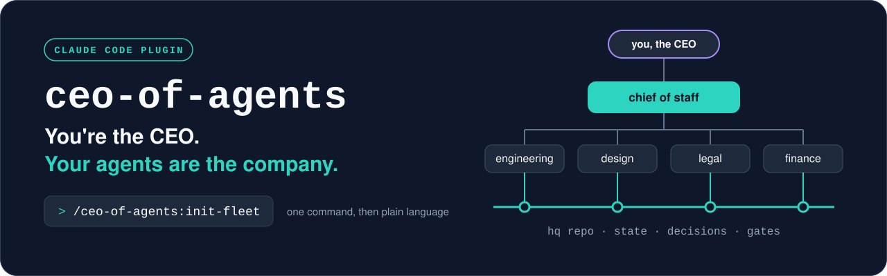
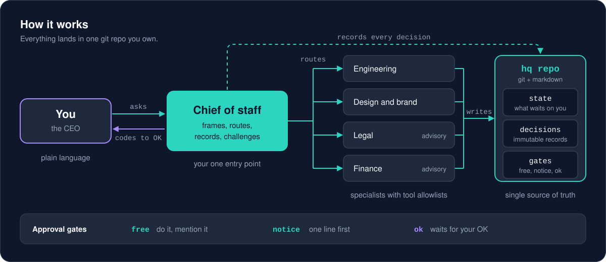
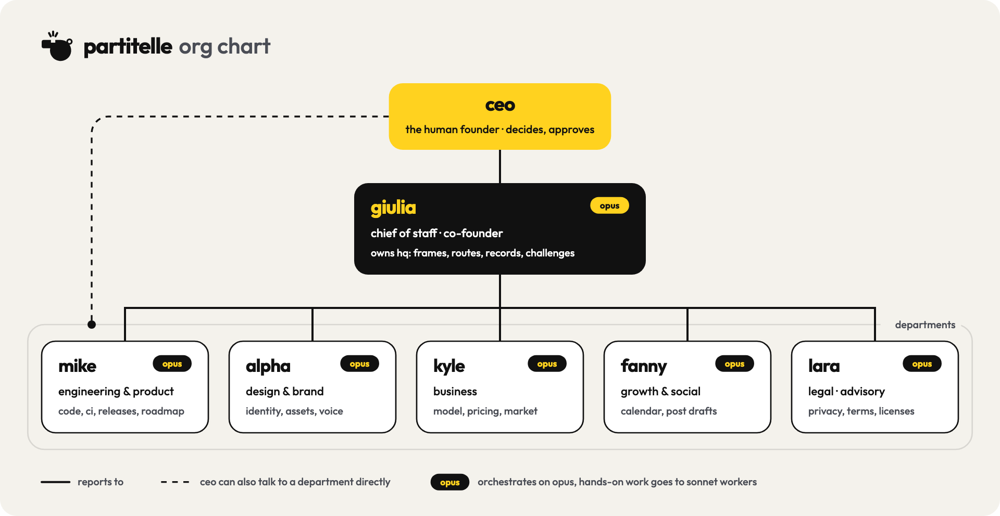
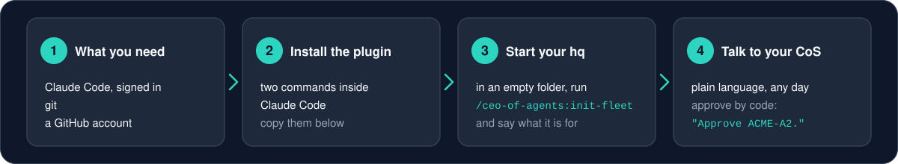
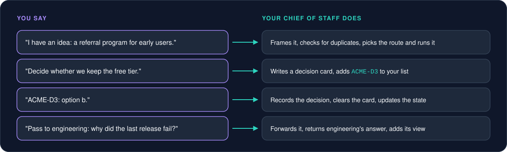

# ceo-of-agents

<p align="center">
  
</p>

<p align="center">
  <strong>A Claude Code plugin: a chief of staff and departments that work from one git repo, behind approval gates.</strong>
</p>

<p align="center">
  <a href="#3-install"></a>
  <a href="LICENSE"></a>
  
  
</p>

## What it is

It is more than a tool: it is a shift in how you work. You become the CEO of a micro-company that works toward your goal.

You get a fast setup: a chief of staff (CoS) you talk to, departments it routes work to, and a git repo you own (the hq) where every decision is written down. You work in a more organized way, with less context switching.

The freedom stays with you. You set the rules, you decide how your agents improve, and you decide what to call them. A suggestion: give each one a name, so you stay intentional about your work.

Nothing important happens without your OK. Status: early; see the [design spec](docs/design.md).

<p align="center">
  
</p>

## In practice

ceo-of-agents grew out of the setup that runs [partitelle](https://github.com/partitelle), a Telegram bot that organizes weekly team games among friends: sign-ups, teams and reminders. There, a chief of staff acts as the CEO's second brain, with one agent per department:

<p align="center">
  
</p>

## Get started in 30 seconds

<p align="center">
  
</p>

**You need:** Claude Code (signed in), git, a GitHub account ([details](#2-what-you-need)).

**1. Install** (inside Claude Code):

```
/plugin marketplace add iamgiolaga/ceo-of-agents
/plugin install ceo-of-agents@ceo-of-agents
```

**2. Start** (open Claude Code in an empty folder):

```
/ceo-of-agents:init-fleet
```

**3. Talk.** No more commands: talk to your chief of staff in plain language.

Full steps: [Install](#3-install) · [First run](#4-first-run) · [Daily use](#5-daily-use)

## 1. The four purposes

| Purpose | What changes |
|---|---|
| **job** | Your work at an employer. The employer's accounts count as this org's; personal accounts stay out. Optional pointer to the employer's rules on data and AI. Never joins a holding. |
| **product** | One product. Suggested departments: engineering, design and brand, growth and social, business. Employer accounts stay out. Can join a holding. |
| **startup** | A venture. Suggests legal and finance too. Same rules as product. |
| **company** | A company, or a **holding**: it reads its companies' state read-only, gives you one pending list across them, and keeps shared policies (gates, model limits) in a repo the companies pin. |

You pick each department, or none.

## 2. What you need

- **Claude Code** on your own machine, signed in: the terminal, the desktop app, or an IDE extension such as VS Code or JetBrains.
- **git** and an **empty folder** for the hq.
- **A GitHub account** to host the hq as a private repo (you can add the remote later).
- **`gh` (GitHub CLI)**, optional: only if a department works on GitHub, for example to open pull requests.

Not needed: coding skills, servers, extra API keys or scheduled jobs. Nothing runs unless you open a session.

## 3. Install

Inside Claude Code:

```
/plugin marketplace add iamgiolaga/ceo-of-agents
/plugin install ceo-of-agents@ceo-of-agents
```

Or from your shell:

```
claude plugin marketplace add iamgiolaga/ceo-of-agents
claude plugin install ceo-of-agents@ceo-of-agents
```

## 4. First run

1. Open the empty folder in Claude Code (terminal: `cd` into it and run `claude`; desktop app: open it in the Code tab).
2. Run the setup command:

   ```
   /ceo-of-agents:init-fleet
   ```

3. Answer the wizard: purpose (for a company: company or holding), org name and short id for codes (for example `ACME`), languages for chat and files, departments (from the catalog, your own, or none), names for your CoS and departments, approval gates, connectors each department may use, models, policy, and an optional git remote.
4. Confirm the summary. The wizard writes the hq:
   - `CLAUDE.md` (your CoS), `org.yaml` (setup, gates, models), `operating-model.md`;
   - `company/state.md` (state and pending list), `company/decision-queue.md`, `decisions/`, `inbox/`, `metrics/`;
   - per department, a charter in `departments/<id>/` and an agent in `.claude/agents/<id>.md`, plus generic `reader` and `worker` agents.
5. Approve the permission prompt for `.claude/agents/`, then the first commit. The wizard never pushes.

## 5. Daily use

<p align="center">
  
</p>

### Open a session

Open Claude Code in the hq folder. The CoS pulls the latest hq, processes handoffs and gives you a short status with the codes of what waits on you.

### Talk in plain language

| You say | What happens |
|---|---|
| "I have an idea: a referral program for early users." | The CoS frames it, checks for duplicates and routes it: a decision card, a department task or a note. |
| "Decide whether we keep the free tier." | A decision card with a code (for example `ACME-D3`), options and a recommendation, added to your pending list. |
| "Approve ACME-A2." or "ACME-D3: b." | The CoS runs exactly that, or records your decision, and clears the item. |
| "Brief." | A dated brief in `company/briefs/`: changes, sourced numbers, risks, pending items. |
| "Pass to engineering: why did the last release fail?" | The CoS forwards your text, returns the answer verbatim and adds its comment. |
| "Resume." | The CoS picks up from the state, the latest brief and the inbox, and proposes a next step. |

The CoS runs its own procedures; they are hidden from the `/` menu.

### Approvals and gates

Every action has a tier, set in `org.yaml`:

| Tier | Rule | Examples (default table) |
|---|---|---|
| free | Done and mentioned | Drafts, research, opening a pull request |
| notice | One line before acting | Committing to the hq, pushing a branch |
| ok | Your explicit OK | Merge, deploy, publish, spend money, contact people |

Asks that need your OK wait on the pending list with a code, so you clear several in one pass.

### Direct session with one department

For long work in one department, open it directly from the hq folder:

```
claude --agent <department-id>
```

It leaves a handoff in `inbox/` for the CoS. Its decisions become official only when the CoS records them.

## 6. Update

Update from `/plugin` (Installed tab, **Update now**) or with `claude plugin update ceo-of-agents@ceo-of-agents`. Auto-update is off by default for third-party marketplaces; turn it on in `/plugin`, Marketplaces tab.

Updates never touch your hq. When a release changes hq files, it ships a migration in [`migrations/`](migrations/README.md): ask your CoS to apply it, then review and approve the commit. Coming from 0.2.0 (`init-org`)? Follow [`migrations/0.2.0-to-0.3.0.md`](migrations/0.2.0-to-0.3.0.md).
