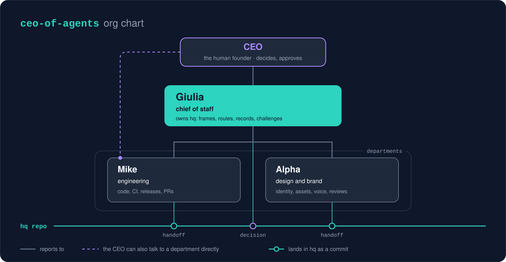

# ceo-of-agents

<p align="center">
  
</p>

<p align="center">
  <strong>A Claude Code plugin: a chief of staff and departments that work from one git repo and ask your OK before anything important.</strong>
</p>

<p align="center">
  <a href="#3-install"></a>
  <a href="LICENSE"></a>
  
  
</p>

https://github.com/user-attachments/assets/4908a78b-c24e-4bcd-ab51-a64db12b38a9

## What it is

It is more than a tool: it is a shift in how you work. You become the CEO of a micro-company that works toward your goal.

You get a fast setup: a chief of staff (CoS) you talk to, departments it routes work to, and a git repo you own (the hq) where every decision is written down. You work in a more organized way, with less context switching.

The freedom stays with you. You set the rules, you decide how your agents improve, and you decide what to call them. A suggestion: give each one a name, so you stay intentional about your work.

If you build a product on GitHub, your fleet can also follow its repos and roadmap, and keep the issues up to date as it works.

Nothing important happens without your OK. Status: early; see the [design notes](docs/design.md).

<p align="center">
  
</p>

## Get started in 30 seconds

<p align="center">
  
</p>

**You need:** Claude Code (signed in), git, a GitHub account ([details](#2-what-you-need)).

**1. Install** (create an empty hq folder inside a parent folder, as shown in [Folders](#folders), and open Claude Code there). Run these two commands one at a time:

1. Add the marketplace:

   ```
   /plugin marketplace add iamgiolaga/ceo-of-agents
   ```

2. Install the plugin. When asked where to install, pick project scope:

   ```
   /plugin install ceo-of-agents@ceo-of-agents
   ```

Using the `/plugin` menu instead? In the "Add Marketplace" field, type only `iamgiolaga/ceo-of-agents`.

**2. Start** (same folder):

```
/ceo-of-agents:init-fleet
```

**3. Talk.** No more commands: talk to your chief of staff in plain language.

Full steps: [Install](#3-install) · [First run](#4-first-run) · [Daily use](#5-daily-use)

## 1. The five purposes

| Purpose | What changes |
|---|---|
| **job** | Your work at an employer. The employer's accounts count as this org's; personal accounts stay out. Optional link to the employer's rules on data and AI. Never joins a holding. |
| **product** | One product. Suggested departments: engineering, design and brand, growth and social, business. Employer accounts stay out. Can join a holding. |
| **startup** | A venture. Suggests legal and finance too. Same rules as product. |
| **company** | A company, or a **holding**: it follows its companies without changing them, gives you one pending list across them, and sets shared rules (approvals, model limits) they follow. |
| **personal** | Your own life: health, money, paperwork. Personal data stays on your computer, out of git. Suggested departments (health, money, paperwork) only prepare and remember: your doctor, accountant or lawyer decides, and they never file, sign or pay. Never joins a holding. |

You pick each department, or none. Except for a holding and personal, setup also suggests a design and brand department: its first task can be to draw your org chart, which your chief of staff offers at the first session.

## 2. What you need

- **Claude Code** on your own machine, signed in: the terminal, the desktop app, or an IDE extension such as VS Code or JetBrains.
- **git** and an **empty folder** for the hq, inside a parent folder ([Folders](#folders)).
- **A GitHub account** to host the hq as a private repo (you can add the remote later).
- **`gh` (GitHub CLI)**, optional: only if your agents work on GitHub, for example to open pull requests or keep your roadmap up to date.

Not needed: coding skills, servers, extra API keys or scheduled jobs. Nothing runs unless you open a session.

## 3. Install

### Folders

Set up your folders once, before you install:

1. Create a parent folder for your GitHub account or organization, and name it after it (for example `my-org`). If you already keep that account's repos in one folder, use that one.
2. Inside it, create an empty folder for the hq (for example `my-org-hq`). This is the folder you open in Claude Code, every time.
3. Product repos (your code), if you have any, go next to the hq, inside the same parent folder. Never put them inside the hq folder: a repo inside another repo mixes your records with code and confuses git.

```
my-org/            <- one folder per GitHub account or organization
  my-org-hq/       <- the hq: run Claude Code here
  product-a/       <- a product repo, next to the hq
  product-b/
```

If the hq is the only thing you keep on GitHub, you have nothing more to do: the parent folder and the hq folder are all you need.

### Install the plugin

Install the plugin in your hq folder, not for your whole computer. Open the empty hq folder in Claude Code (terminal: `cd` into it and run `claude`; desktop app: open it in the Code tab), then run these two commands one at a time:

1. Add the marketplace:

   ```
   /plugin marketplace add iamgiolaga/ceo-of-agents
   ```

2. Install the plugin. When asked where to install, pick project scope:

   ```
   /plugin install ceo-of-agents@ceo-of-agents
   ```

Using the `/plugin` menu instead? In the "Add Marketplace" field, type only `iamgiolaga/ceo-of-agents`.

Or from your shell, inside that folder:

```
claude plugin marketplace add iamgiolaga/ceo-of-agents
claude plugin install ceo-of-agents@ceo-of-agents --scope project
```

The plugin is then turned on in the folder's `.claude/settings.json`, so it loads only in your hq. Install it once, at project scope only: a second copy at another scope can stay on an older version and be the one that loads. On another computer, run the same commands inside your hq's clone.

## 4. First run

1. Open the same folder in Claude Code, if it is not open already.
2. Run the setup command:

   ```
   /ceo-of-agents:init-fleet
   ```

3. Answer the setup questions: the language to chat in (asked first, unless you already wrote something), purpose (for a company: company or holding), org name and short id for codes (for example `ACME`), what the org does and why, the language of the files, departments (from the catalog, your own, or none), names for your CoS and departments, approval rules, which Claude models to use, a holding's shared rules if any, an optional GitHub repo, your product's repos and roadmap board if you have them, and how commits and pull requests are signed.

   Optional answers can be "later": your chief of staff puts them on your list to answer later.
4. Confirm the summary, and your hq is ready: your chief of staff and departments are set up in a git repo you own.
5. Approve the permission prompt that appears, then the first save (commit). The setup never pushes: you choose when.

## 5. Daily use

<p align="center">
  
</p>

### Open a session

Open Claude Code in the hq folder. The CoS gets the latest hq, reads what departments left for it and gives you a short status with the codes of what waits on you.

Your hq grows every day, but each session reads only a small set of files at the start. If those files grow past their size budget, the CoS says so and offers to move the detail into linked notes. Old documents can be archived: they move to `archive/`, stay in git, and stop showing up in everyday searches.

### Talk in plain language

| You say | What happens |
|---|---|
| "I have an idea: a referral program for early users." | The CoS frames it, checks for duplicates and routes it: a decision card, a department task or a note. |
| "Decide whether we keep the free tier." | A decision card with a code (for example `ACME-D3`), options and a recommendation, added to your pending list. |
| "Approve ACME-A2." or "ACME-D3: b." | The CoS runs exactly that, or records your decision, and clears the item. |
| "Brief." | A dated brief, saved in the hq: changes, sourced numbers, risks, pending items. |
| "Pass to engineering: why did the last release fail?" | The CoS forwards your text, returns the answer verbatim and adds its comment. |
| "Resume." | The CoS picks up from the state, the latest brief and the inbox, and proposes a next step. |

### What needs your OK

Your agents do safe things on their own (drafts, research), tell you before saving changes, and ask for your OK before anything that goes outside or can't be undone: merging, publishing, spending money, contacting people. What waits for you gets a short code, so you can approve several at once (for example "approve ACME-A2").

On a repo that other people work on, your agents ask you before they write anything there, even an issue or a comment. Setup asks about each repo you register, except the hq, which is yours.

### Direct session with one department

For long work in one department, open it directly from the hq folder:

```
claude --agent mike
```

Use the name you gave the department, in lowercase (for example `mike`), or its role (for example `engineering`) if you kept the role name. It leaves a note for the CoS; its decisions count only once the CoS records them.

## 6. Update

Update from `/plugin` (Installed tab, **Update now**) or, inside your hq folder, with `claude plugin update ceo-of-agents@ceo-of-agents --scope project`. Auto-update is off by default for third-party marketplaces; turn it on in `/plugin`, Marketplaces tab.

If you also installed the plugin for your whole computer (user scope), check `/plugin`, Installed tab, and remove the extra copy with `claude plugin uninstall ceo-of-agents@ceo-of-agents --scope user`; otherwise an older copy may be the one that loads. Install it at project scope in each of your hqs first.

Updates never touch your hq.

When the plugin updates, your chief of staff notices at the start of a session and offers to bring your hq up to date.

Nothing in your hq changes until you say OK. Each update is described in [`migrations/`](migrations/README.md); your CoS shows a short summary of what changed and saves it as one commit per update.

## 7. Built with ceo-of-agents

### &nbsp; [partitelle](https://github.com/partitelle)

Organize your weekly game without the group-chat chaos: sign-ups, teams and reminders, all handled for you.

Run by a CEO, a chief of staff and five departments: engineering and product, design and brand, business, growth and social, and legal (advisory).


### ceo-of-agents

This plugin is built by its own fleet: a chief of staff and two departments, with the same structure.


